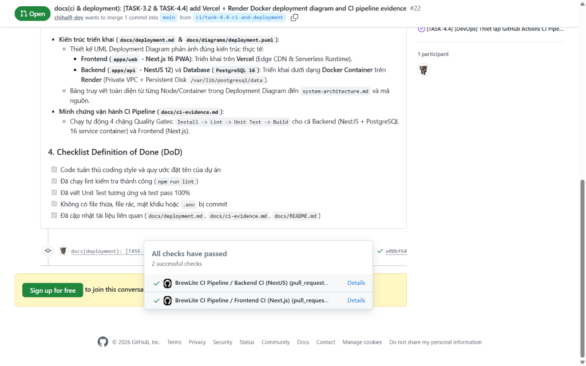
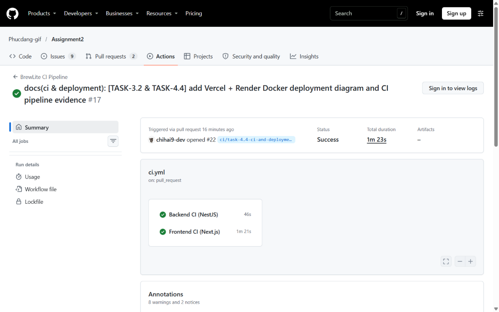
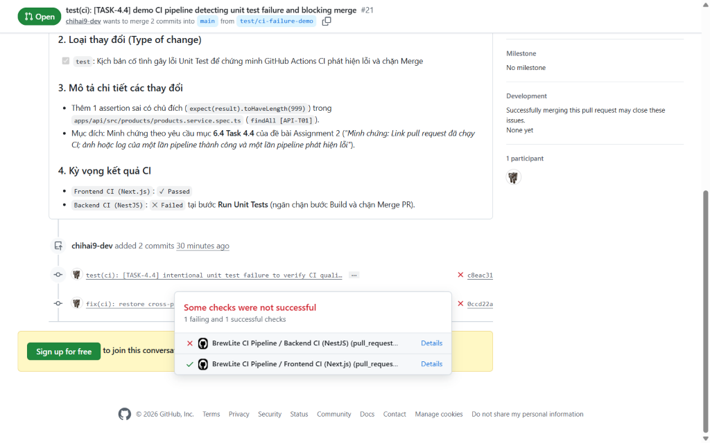
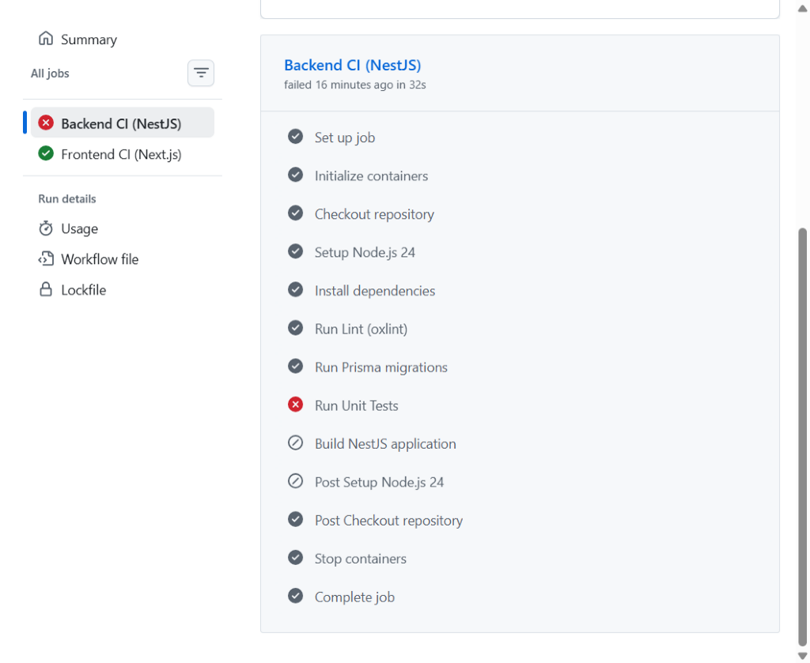

# Báo Cáo & Minh Chứng Pipeline CI (Continuous Integration Report) - Task 4.4

> **Dự án**: BrewLite – Cashless Coffee Ordering System  
> **Học phần**: Công nghệ Phần mềm (Software Engineering) – Assignment 2  
> **Nhiệm vụ**: Task 4.4 – Thiết lập Continuous Integration & Minh chứng vận hành thực tế  
> **Trạng thái**: Hoàn thành vận hành trên GitHub Actions (Đã có PR Pass & PR Fail thực tế)  
> **Kiến trúc triển khai liên kết**: Frontend trên **Vercel**, Backend (NestJS) & Database (PostgreSQL 16) chạy **Docker Container trên Render** (xem chi tiết tại [`docs/deployment.md`](deployment.md)).

---

## 1. Mục tiêu & Nguyên tắc Hoạt động

Theo yêu cầu của đề bài mục **6.4 Task 4.4**, pipeline CI (`.github/workflows/ci.yml`) được thiết lập để tự động kích hoạt khi có:
* Thao tác **Push** lên nhánh `main` hoặc `develop`.
* Thao tác mở **Pull Request (PR)** hướng vào nhánh `main` hoặc `develop`.

Pipeline bắt buộc phải vượt qua 4 chặng kiểm soát chất lượng (Quality Gates) theo đúng thứ tự:

$$\textbf{Install} \longrightarrow \textbf{Lint} \longrightarrow \textbf{Unit Test} \longrightarrow \textbf{Build}$$

> [!IMPORTANT]
> **Quy tắc chặn nghiêm ngặt (Branch Protection)**: Pull Request tuyệt đối không được phép merge vào `main` nếu bất kỳ bước nào trong 4 bước trên thất bại. Khi một bước bị lỗi (ví dụ `Run Unit Tests`), các bước kế tiếp (`Build`) lập tức bị hủy bỏ (`Skipped`) và PR bị đánh dấu `✕ Some checks were not successful`.

---

## 2. Cấu trúc Pipeline CI ([`.github/workflows/ci.yml`](../.github/workflows/ci.yml))

Pipeline được chia làm 2 jobs độc lập chạy song song trên GitHub-hosted runner `ubuntu-latest` (Node.js 24):

### Job 1: Backend CI (`apps/api` - NestJS)
1. **Khởi tạo dịch vụ PostgreSQL (`services.postgres`)**: Chạy container `postgres:16-alpine` (cổng `5432`, DB `brewlite_test`) kèm healthcheck `pg_isready` làm cơ sở dữ liệu kiểm thử độc lập, đồng nhất với container PostgreSQL trên Render.
2. **Install (`npm ci`)**: Cài đặt chính xác các phụ thuộc dựa trên `apps/api/package-lock.json`.
3. **Lint (`npm run lint`)**: Sử dụng `oxlint` quét lỗi cú pháp, kiểu dữ liệu và quy chuẩn code.
4. **Prisma Migrate (`npx prisma migrate deploy`)**: Đồng bộ hóa schema từ `apps/api/prisma/migrations/` vào database kiểm thử.
5. **Unit Test (`npm test -- --passWithNoTests`)**: Chạy bộ kiểm thử tự động với Jest (`AppController` & `ProductsService` - `API-T01`).
6. **Build (`npm run build`)**: Biên dịch mã nguồn NestJS sang JavaScript (`dist/`), sẵn sàng đóng gói Docker container lên Render.

### Job 2: Frontend CI (`apps/web` - Next.js)
1. **Install (`npm ci`)**: Cài đặt phụ thuộc từ `apps/web/package-lock.json`.
2. **Lint (`npm run lint`)**: Kiểm tra ESLint cho Next.js App Router và TypeScript.
3. **Build (`npm run build`)**: Biên dịch gói ứng dụng Next.js production, sẵn sàng triển khai lên Vercel CDN.

---

## 3. Hướng Dẫn Cấu Hình Branch Protection Trên GitHub

Để thỏa mãn tiêu chí *"Pull request không được merge nếu lint, test hoặc build thất bại"*, nhóm thiết lập quy tắc bảo vệ nhánh `main` trên GitHub:

1. Vào repository [`Phucdang-gif/Assignment2`](https://github.com/Phucdang-gif/Assignment2) ➔ **Settings** ➔ **Branches**.
2. Nhấn **Add branch protection rule** cho nhánh `main`.
3. Tích chọn các mục kiểm soát chất lượng:
   - [x] **Require a pull request before merging**
   - [x] **Require status checks to pass before merging**:
     - `Backend CI (NestJS)`
     - `Frontend CI (Next.js)`
   - [x] **Require branches to be up to date before merging**
   - [x] **Do not allow bypassing the above settings**

---

## 4. Minh Chứng Vận Hành Thực Tế (Evidence Logs & Screenshots)

### 4.1. Minh chứng 1: Pull Request chạy Pipeline CI Thành Công (CI Pass)

* **Pull Request Thành Công (CI Pass)**:
  * **PR #22**: [`https://github.com/Phucdang-gif/Assignment2/pull/22`](https://github.com/Phucdang-gif/Assignment2/pull/22) *(Nhánh `ci/task-4.4-ci-and-deployment` ➔ `main`)*
  * **PR #19**: [`https://github.com/Phucdang-gif/Assignment2/pull/19`](https://github.com/Phucdang-gif/Assignment2/pull/19) *(Nhánh `ci/task-4.4-continuous-integration` ➔ `main`)*
* **Link GitHub Actions Workflow Run**:
  * Run [`#42985903031`](https://github.com/Phucdang-gif/Assignment2/actions/runs/42985903031)
  * Job `Backend CI (NestJS)`: [`https://github.com/Phucdang-gif/Assignment2/actions/runs/42985903031/job/130406877961`](https://github.com/Phucdang-gif/Assignment2/actions/runs/42985903031/job/130406877961) (`✓ Success` trong 46s)
  * Job `Frontend CI (Next.js)`: [`https://github.com/Phucdang-gif/Assignment2/actions/runs/42985903031/job/130406878399`](https://github.com/Phucdang-gif/Assignment2/actions/runs/42985903031/job/130406878399) (`✓ Success` trong 1m 21s)
* **Kết quả**: Cả 2 jobs đều vượt qua toàn bộ 4 bước **Install ➔ Lint ➔ Unit Test ➔ Build** (`All checks have passed - 2 successful checks`), cho phép Merge vào nhánh `main`.

#### Ảnh chụp màn hình trạng thái CI Pass trên Pull Request #22:


#### Ảnh chụp màn hình tổng quan Workflow Run thành công trên GitHub Actions:


```text
✓ BrewLite CI Pipeline / Backend CI (NestJS) (pull_request) — Passed in 46s
  ├─ ✓ Initialize containers (postgres:16-alpine)
  ├─ ✓ Install dependencies (npm ci)
  ├─ ✓ Run Lint (oxlint) — 0 warnings, 0 errors
  ├─ ✓ Run Prisma migrations (npx prisma migrate deploy)
  ├─ ✓ Run Unit Tests (Jest: 2 passed, 2 total)
  └─ ✓ Build NestJS application (nest build)
✓ BrewLite CI Pipeline / Frontend CI (Next.js) (pull_request) — Passed in 1m 21s
  ├─ ✓ Install dependencies (npm ci)
  ├─ ✓ Run Lint (ESLint)
  └─ ✓ Build Next.js application (next build)
Result: All checks have passed (2 successful checks). Merging is allowed.
```

---

### 4.2. Minh chứng 2: Pull Request có lỗi bị Pipeline CI Phát Hiện & Chặn Merge (CI Fail)

* **Pull Request Kiểm Thử Lỗi (CI Fail)**:
  * **PR #21**: [`https://github.com/Phucdang-gif/Assignment2/pull/21`](https://github.com/Phucdang-gif/Assignment2/pull/21) *(Nhánh `test/ci-failure-demo` ➔ `main`)*
* **Link GitHub Actions Workflow Run & Job Log**:
  * Run [`#42985734778`](https://github.com/Phucdang-gif/Assignment2/actions/runs/42985734778)
  * Job `Backend CI (NestJS)` (Failed): [`https://github.com/Phucdang-gif/Assignment2/actions/runs/42985734778/job/130406327406`](https://github.com/Phucdang-gif/Assignment2/actions/runs/42985734778/job/130406327406)
* **Kịch bản gây lỗi có chủ đích**:
  1. Tạo nhánh `test/ci-failure-demo` từ `main`.
  2. Trong tệp [`apps/api/src/products/products.service.spec.ts`](../apps/api/src/products/products.service.spec.ts), thêm kỳ vọng sai có chủ đích `expect(result).toHaveLength(999)` trong test case `findAll [API-T01]`.
  3. Mở Pull Request **#21** hướng vào nhánh `main`.
* **Kết quả**:
  * GitHub Actions chạy qua `Install dependencies` (`✓`), `Run Lint (oxlint)` (`✓`), `Run Prisma migrations` (`✓`), và **phát hiện lỗi ngay tại bước `Run Unit Tests` (`✕`)**.
  * Bước `Build NestJS application` tự động bị chặn/bỏ qua (`⊘ Skipped`), và Pull Request #21 bị cảnh báo đỏ **`Some checks were not successful (1 failing and 1 successful checks)`**.

#### Ảnh chụp màn hình trạng thái CI Fail trên Pull Request #21:


#### Ảnh chụp màn hình chi tiết bước `Run Unit Tests` thất bại và chặn bước `Build`:


```text
✕ BrewLite CI Pipeline / Backend CI (NestJS) (pull_request) — Failed in 32s
  ├─ ✓ Set up job & Initialize containers (postgres:16-alpine)
  ├─ ✓ Install dependencies (npm ci)
  ├─ ✓ Run Lint (oxlint)
  ├─ ✓ Run Prisma migrations
  ├─ ✕ Run Unit Tests — FAIL src/products/products.service.spec.ts
  │    ● ProductsService › findAll [API-T01] › should return an array of active products with categories
  │      expect(received).toHaveLength(expected)
  │      Expected length: 999
  │      Received length: 1
  └─ ⊘ Build NestJS application (Skipped due to previous step failure)
Result: Some checks were not successful. Merging is blocked by CI Quality Gate.
```
