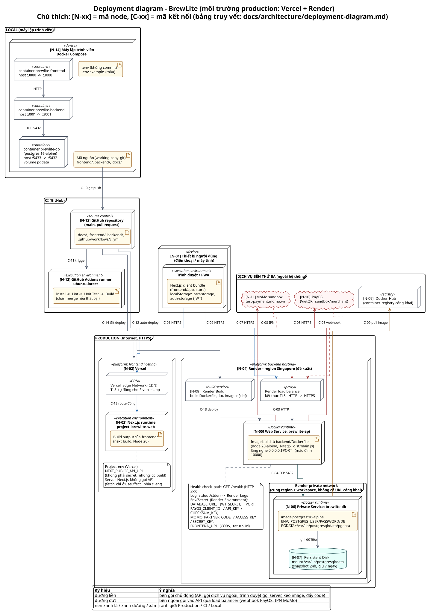
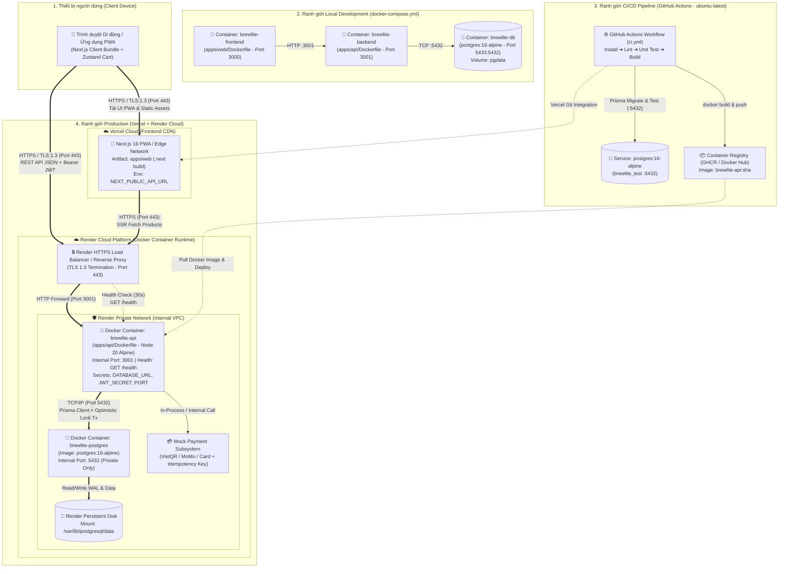

# Sơ Đồ Triển Khai & Hướng Dẫn Môi Trường Production (Deployment Architecture) - Task 3.2

> **Dự án**: BrewLite – Cashless Coffee Ordering System  
> **Học phần**: Công nghệ Phần mềm (Software Engineering) – Assignment 2  
> **Nhiệm vụ**: Task 3.2 – Thiết kế UML Deployment Diagram & Đặc tả môi trường triển khai thực tế  
> **Nền tảng sử dụng**:
> - **Frontend (`apps/web`)**: Triển khai trên **Vercel** (Global Edge Network & Serverless Runtime).
> - **Backend (`apps/api`)**: Đóng gói **Docker Container** (`apps/api/Dockerfile`) và triển khai trên **Render**.
> - **Database (`PostgreSQL 16`)**: Triển khai dưới dạng **Docker Container** (`postgres:16-alpine`) gắn **Persistent Disk Storage** trên **Render** (Private Network).
> - **CI/CD**: **GitHub Actions** (`.github/workflows/ci.yml`) kết hợp **GitHub Container Registry (GHCR)**.

---

## 1. Tổng Quan Kiến Trúc Triển Khai (Deployment Overview)

Mô hình triển khai của **BrewLite** tách biệt rõ ràng thành **3 ranh giới môi trường (Environment Boundaries)**:
1. **Ranh giới Local Development**: Dành cho lập trình viên chạy toàn bộ hệ thống (`frontend`, `backend`, `db`) độc lập trên máy cá nhân thông qua `docker-compose.yml`.
2. **Ranh giới CI/CD (GitHub Actions)**: Tự động kích hoạt khi có sự kiện `push` hoặc `pull_request` vào nhánh `main`/`develop`, thực thi chuỗi kiểm soát chất lượng **Install → Lint → Unit Test → Build** cùng container `postgres:16-alpine` kiểm thử độc lập, trước khi đóng gói Docker image và kích hoạt triển khai.
3. **Ranh giới Production (Vercel + Render Docker Containers)**:
   - **Vercel** phục vụ ứng dụng Next.js 16 (App Router / Mobile-first PWA) qua mạng lưới CDN toàn cầu với chứng chỉ HTTPS tự động.
   - **Render** vận hành hai **Docker Containers** nằm trong cùng một mạng nội bộ (**Render Private Network**):
     - Container **Backend NestJS API** (`apps/api/Dockerfile`) lắng nghe tại cổng nội bộ `3001`, nhận lưu lượng HTTPS từ Render Reverse Proxy (cổng `443`).
     - Container **PostgreSQL 16** (`postgres:16-alpine`) lắng nghe tại cổng nội bộ `5432` (không mở public ra ngoài internet) và gắn ổ đĩa cứng bền vững **Render Persistent Disk** tại `/var/lib/postgresql/data`.

---

## 2. Sơ Đồ Triển Khai UML (UML Deployment Diagram)

> **Tệp nguồn PlantUML & Vector SVG**:
> - PlantUML chi tiết ([N-xx] Node & [C-xx] Connection): [`docs/diagrams/deployment-diagram.puml`](diagrams/deployment-diagram.puml)
> - PlantUML kiến trúc rút gọn: [`docs/diagrams/deployment.puml`](diagrams/deployment.puml)
> - Ảnh vector chất lượng cao: [`docs/diagrams/deployment-diagram.svg`](diagrams/deployment-diagram.svg)

### 2.1. Sơ đồ luồng kết nối tương tác (Interactive Mermaid Flowchart)

---

## 3. Đặc Tả Kết Nối, Giao Thức, Bảo Mật và Giám Sát

### 3.1. Giao thức mạng và Cổng kết nối (Network Protocols & Ports)

| Điểm đầu (Source) | Điểm cuối (Destination) | Giao thức | Cổng (Port) | Phạm vi mạng | Mục đích sử dụng |
| :--- | :--- | :---: | :---: | :---: | :--- |
| **Client Browser / PWA** | **Vercel Edge CDN** | `HTTPS` (TLS 1.3) | `443` | Public Internet | Tải giao diện Next.js PWA, static assets, manifest và caching. |
| **Client Browser / Vercel** | **Render Ingress Proxy** | `HTTPS` (TLS 1.3) | `443` | Public Internet | Gọi RESTful API (`/products`, `/auth/*`, `/orders`, `/payments`) kèm header `Authorization: Bearer <JWT>`. |
| **Render Ingress Proxy** | **Container `brewlite-api`** | `HTTP` | `3001` | Render Internal | Chuyển tiếp request đã giải mã SSL vào container NestJS và kiểm tra định kỳ `GET /health`. |
| **Container `brewlite-api`** | **Container `brewlite-postgres`** | `TCP/IP` (Postgres Wire) | `5432` | Render Private VPC | Thực thi truy vấn Prisma ORM, ACID Transaction tạo đơn và khóa lạc quan (`version`). **Tuyệt đối không mở public port 5432 ra internet.** |

### 3.2. Quản lý Biến Môi Trường & Bí Mật (Secrets & Environment Variables)

Không có bất kỳ mật khẩu hay khóa bí mật thực tế nào được lưu trong kho mã nguồn (`.env` đã được chặn trong `.gitignore`, chỉ cung cấp khuôn mẫu tại [`.env.example`](../.env.example)).

* **Trên Vercel (Frontend Settings → Environment Variables)**:
  * `NEXT_PUBLIC_API_URL`: Đường dẫn HTTPS trỏ tới dịch vụ Backend trên Render (ví dụ: `https://brewlite-api.onrender.com`).
* **Trên Render (Backend Container → Environment & Secret Files)**:
  * `DATABASE_URL`: Chuỗi kết nối nội bộ tới container PostgreSQL trên Render (`postgresql://brewlite:<password>@brewlite-postgres:5432/brewlite?schema=public`).
  * `JWT_SECRET`: Khóa bí mật 256-bit sinh ngẫu nhiên dùng để ký và xác thực JWT Token.
  * `PORT`: `3001` (cổng nội bộ mà NestJS lắng nghe trên `0.0.0.0:3001`).
* **Trên GitHub Actions (Repository Settings → Secrets and variables → Actions)**:
  * `RENDER_DEPLOY_HOOK_URL`: Webhook bí mật để kích hoạt Render kéo Docker image mới sau khi CI pass.
  * `VERCEL_TOKEN` / Git Integration: Tự động triển khai bản build Frontend khi PR được merge vào `main`.

### 3.3. Cơ chế Health Check, Migration An Toàn & Logging

1. **Health Check Endpoint (`GET /health`)**:
   * Được cài đặt tại [`apps/api/src/app.controller.ts`](../apps/api/src/app.controller.ts) và [`apps/api/src/app.service.ts`](../apps/api/src/app.service.ts).
   * Render cấu hình `Health Check Path: /health`. Nếu container mới khởi chạy không phản hồi `200 OK`, Render tự động hủy bản triển khai lỗi và giữ nguyên container phiên bản cũ đang chạy (Zero-downtime Rollback).
2. **Database Migration khi khởi chạy Container**:
   * Trong [`apps/api/Dockerfile`](../apps/api/Dockerfile), quá trình build thực thi `npx prisma generate` và khi khởi động container sẽ đồng bộ schema cơ sở dữ liệu trước khi khởi chạy `node dist/main.js`.
3. **Tập trung hóa Log (Structured Logging)**:
   * Toàn bộ log truy cập, lỗi xác thực JWT, xung đột khóa lạc quan tồn kho và đối soát `idempotencyKey` được ghi ra `stdout`/`stderr` của Docker container và thu thập trực tiếp trên **Render Log Streams** cũng như **Vercel Runtime Logs**.

---

## 4. Bảng Truy Vết Thành Phần Triển Khai (Deployment Traceability Matrix)

Đáp ứng tiêu chí nghiệm thu mục **5.2 Task 3.2**: *"Có thể truy vết mỗi container/dịch vụ trong deployment diagram đến một thành phần trong mô tả kiến trúc và mã nguồn"*.

| Node / Container trong Deployment Diagram | Nền tảng vận hành | Thành phần trong Mô tả Kiến trúc (`system-architecture.md`) | Tệp cấu hình & Mã nguồn tương ứng trong Repository |
| :--- | :--- | :--- | :--- |
| **`Client Device (Mobile Browser / PWA)`** | Thiết bị người dùng (iOS / Android / Desktop) | **Client Tier** & **C4 Level 1 Actor** (`Customer`, `Barista`) | [`apps/web/app/layout.tsx`](../apps/web/app/layout.tsx) [`apps/web/store/cartStore.ts`](../apps/web/store/cartStore.ts) |
| **`Vercel Edge Network / BrewLite Web App`** | **Vercel Cloud** (Frontend Hosting & CDN) | **Presentation Tier** – Container `Web Application (PWA)` (Next.js) | [`apps/web/package.json`](../apps/web/package.json) [`apps/web/next.config.ts`](../apps/web/next.config.ts) [`apps/web/Dockerfile`](../apps/web/Dockerfile) [`apps/web/app/page.tsx`](../apps/web/app/page.tsx) |
| **`Docker Container: brewlite-api`** | **Render Cloud** (Docker Web Service) | **Application Tier** – Container `API Application` (NestJS Modular Monolith: `AuthModule`, `ProductsModule`, `OrdersModule`, `PaymentsModule`) | [`apps/api/Dockerfile`](../apps/api/Dockerfile) [`apps/api/src/main.ts`](../apps/api/src/main.ts) [`apps/api/src/app.module.ts`](../apps/api/src/app.module.ts) [`apps/api/src/app.controller.ts`](../apps/api/src/app.controller.ts) (`GET /health`) |
| **`Docker Container: brewlite-postgres` + `Render Persistent Disk`** | **Render Cloud** (Docker Private Service + Persistent Disk `/var/lib/postgresql/data`) | **Data Tier** – Container `Database` (PostgreSQL 16 + Prisma ORM + Optimistic Locking) | [`docker-compose.yml`](../docker-compose.yml) (`image: postgres:16-alpine`) [`apps/api/prisma/schema.prisma`](../apps/api/prisma/schema.prisma) [`apps/api/prisma/migrations/`](../apps/api/prisma/migrations/) [`apps/api/prisma/seed.js`](../apps/api/prisma/seed.js) |
| **`Mock Payment Subsystem`** | Nội bộ trong Container `brewlite-api` trên Render | **Integration Tier** – `Mock Payment Service` (VietQR / MoMo / Card + Idempotency Key) | [`apps/api/src/payments/payments.controller.ts`](../apps/api/src/payments/payments.controller.ts) [`apps/api/src/payments/payments.service.ts`](../apps/api/src/payments/payments.service.ts) [`docs/architecture/adr/004-payment-simulation-and-idempotency.md`](architecture/adr/004-payment-simulation-and-idempotency.md) |
| **`GitHub Actions Runner (ubuntu-latest)`** | **GitHub Actions** CI/CD | **NFR-05 (Deployability)** & [`ADR-001`](architecture/adr/001-monorepo.md), [`ADR-006`](architecture/adr/006-logging-healthcheck-and-configuration.md) | [`.github/workflows/ci.yml`](../.github/workflows/ci.yml) [`docs/ci-evidence.md`](ci-evidence.md) |
| **`Local Docker Engine`** | Máy trạm Lập trình viên (Docker Desktop) | Môi trường phát triển & kiểm thử tích hợp cục bộ (Local Environment) | [`docker-compose.yml`](../docker-compose.yml) [`.env.example`](../.env.example) |
