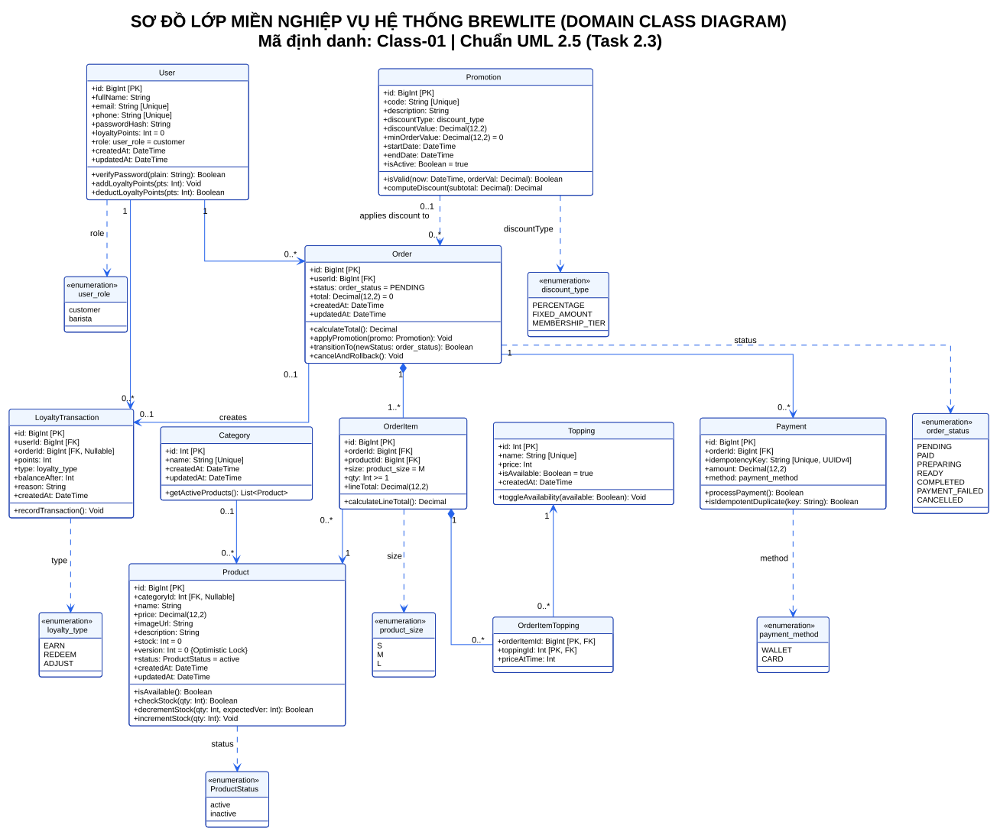

# Thiết Kế Sơ Đồ Lớp Miền Nghiệp Vụ (Task 2.3 - Domain Class Diagram)

> **Dự án**: BrewLite – Coffee Ordering System  
> **Học phần**: Công nghệ Phần mềm (Software Engineering) – Assignment 2  
> **Nhiệm vụ**: **Task 2.3 – Vẽ Class Diagram ở mức Domain**  
> **Mã định danh truy vết**: `Class-01`  
> **Chuẩn thiết kế**: UML 2.5 Specification  
> **Tệp mã nguồn PlantUML**: [`docs/diagrams/class-diagram.puml`](./class-diagram.puml)  
> **Tệp ảnh Vector SVG**: [`docs/diagrams/class-diagram.svg`](./class-diagram.svg)  
> **Tệp ảnh Bitmap PNG**: [`docs/diagrams/class-diagram.png`](./class-diagram.png)  
> **Tệp tài liệu PDF**: [`docs/diagrams/class-diagram.pdf`](./class-diagram.pdf)  

---

## 1. Giới thiệu tổng quan & Mục tiêu thiết kế

Tài liệu này hiện thực hóa **Task 2.3** của đồ án BrewLite, xây dựng sơ đồ lớp ở mức **Domain Model** (mô hình miền nghiệp vụ). Sơ đồ biểu diễn cấu trúc thông tin tĩnh của hệ thống, bao gồm các thực thể cốt lõi, thuộc tính, hành vi nghiệp vụ, quan hệ cấu trúc, ràng buộc đa số (*multiplicity*), và các kiểu liệt kê trạng thái (*enumerations*).

### Yêu cầu tiên quyết từ đề bài (Assignment 2 - Task 2.3):
1. **Bắt buộc có tối thiểu 7 lớp**: `User`, `Product`, `Order`, `OrderItem`, `Payment`, `Promotion`, và `LoyaltyTransaction`.
2. **Thể hiện đầy đủ**: Thuộc tính chính, quan hệ, multiplicity và enum trạng thái.
3. **Tiêu chí nghiệm thu khắt khe**: Ba loại sơ đồ (Activity, Sequence, Class) **tuyệt đối không mâu thuẫn với SRS, Use-case hoặc Mô hình dữ liệu thực tế (`brewlite_seed_data.sql` & `schema.prisma`)**.

---

## 2. Sơ đồ trực quan (Domain Class Diagram)

---

## 3. Đặc tả chi tiết các Lớp Miền Nghiệp Vụ (Domain Entities)

Sơ đồ bao gồm **12 thực thể** (đáp ứng trọn vẹn 7 thực thể bắt buộc + 5 thực thể phân loại danh mục, topping, nguyên vật liệu và công thức pha chế theo CSDL thực tế):

### 3.1. Nhóm Người dùng & Khách hàng thân thiết
1. **`User`**: Đại diện cho tài khoản người dùng trong hệ thống (khách hàng, nhân viên pha chế hoặc quản trị viên).
   * **Thuộc tính**: `id: BigInt [PK]`, `fullName: String`, `email: String [Unique]`, `phone: String [Unique]`, `passwordHash: String`, `loyaltyPoints: Int = 0`, `role: user_role = customer`, `createdAt: DateTime`, `updatedAt: DateTime`.
   * **Phương thức**: `verifyPassword(plain: String): Boolean`, `addLoyaltyPoints(pts: Int): Void`, `deductLoyaltyPoints(pts: Int): Boolean`.
2. **`LoyaltyTransaction`**: Lưu vết chi tiết từng biến động điểm thưởng của khách hàng (yêu cầu bắt buộc của đề bài).
   * **Thuộc tính**: `id: BigInt [PK]`, `userId: BigInt [FK]`, `orderId: BigInt [FK, Nullable]`, `points: Int`, `type: loyalty_type (EARN/REDEEM/ADJUST)`, `balanceAfter: Int`, `reason: String`, `createdAt: DateTime`.
   * **Phương thức**: `recordTransaction(): Void`.

### 3.2. Nhóm Danh mục, Sản phẩm & Nguyên vật liệu - Công thức
3. **`Category`**: Phân loại thức uống (Cà phê, Trà trái cây, Trà sữa, Đá xay & Thức uống khác).
   * **Thuộc tính**: `id: Int [PK]`, `name: String [Unique]`, `createdAt: DateTime`, `updatedAt: DateTime`.
   * **Phương thức**: `getActiveProducts(): List<Product>`.
4. **`Product`**: Sản phẩm đồ uống kinh doanh tại quán. Tồn kho không lưu cột tĩnh mà tính toán động dựa trên nguyên liệu tồn kho và định mức tiêu hao trong công thức.
   * **Thuộc tính**: `id: BigInt [PK]`, `categoryId: Int [FK, Nullable]`, `name: String`, `price: Decimal(12,2)`, `imageUrl: String`, `description: String`, `version: Int = 0 {Optimistic Lock}`, `status: ProductStatus = active`, `createdAt: DateTime`, `updatedAt: DateTime`.
   * **Phương thức**: `isAvailable(): Boolean`, `calculateStock(size: product_size): Int`, `checkStock(size: product_size, qty: Int): Boolean`, `deductIngredients(size: product_size, qty: Int): Boolean`.
5. **`Topping`**: Các loại món thêm kèm theo (trân châu đen, thạch dừa, kem cheese).
   * **Thuộc tính**: `id: Int [PK]`, `name: String [Unique]`, `price: Int`, `isAvailable: Boolean = true`, `createdAt: DateTime`.
   * **Phương thức**: `toggleAvailability(available: Boolean): Void`.
6. **`Ingredient`**: Nguyên vật liệu trong kho (hạt cà phê Robusta/Arabica, sữa đặc, sữa tươi, siro, trà đen,...).
   * **Thuộc tính**: `id: Int [PK]`, `name: String`, `unit: String`, `stock: Int = 0`, `createdAt: DateTime`, `updatedAt: DateTime`.
   * **Phương thức**: `hasEnoughStock(required: Int): Boolean`, `deductStock(amount: Int): Boolean`, `restock(amount: Int): Void`.
7. **`ProductRecipeItem`**: Định mức tiêu hao nguyên vật liệu cho từng ly theo từng kích cỡ (BOM / Recipe).
   * **Thuộc tính**: `id: Int [PK]`, `productId: BigInt [FK]`, `size: product_size`, `ingredientId: Int [FK]`, `amount: Int`, `unit: String`, `createdAt: DateTime`, `updatedAt: DateTime`.
   * **Phương thức**: `calculateUsage(qty: Int): Int`.

### 3.3. Nhóm Đơn hàng & Chi tiết món
8. **`Order`**: Đơn đặt hàng được khởi tạo bởi khách hàng.
   * **Thuộc tính**: `id: BigInt [PK]`, `userId: BigInt [FK]`, `promotionId: BigInt [FK, Nullable]`, `status: order_status = PENDING`, `subtotal: Decimal(12,2) = 0`, `discountAmount: Decimal(12,2) = 0`, `total: Decimal(12,2) = 0`, `createdAt: DateTime`, `updatedAt: DateTime`.
   * **Phương thức**: `calculateTotal(): Decimal`, `applyPromotion(promo: Promotion): Void`, `transitionTo(newStatus: order_status): Boolean`, `cancelAndRollback(): Void`.
9. **`OrderItem`**: Từng dòng sản phẩm trong đơn hàng (kèm kích cỡ, đơn giá, số lượng và thành tiền).
   * **Thuộc tính**: `id: BigInt [PK]`, `orderId: BigInt [FK]`, `productId: BigInt [FK]`, `size: product_size = M`, `qty: Int >= 1`, `unitPrice: Decimal(12,2) = 0`, `lineTotal: Decimal(12,2)`.
   * **Phương thức**: `calculateLineTotal(): Decimal`.
10. **`OrderItemTopping`**: Bảng kết hợp trung gian liên kết topping chọn cho từng món.
    * **Thuộc tính**: `orderItemId: BigInt [PK, FK]`, `toppingId: Int [PK, FK]`, `priceAtTime: Int`.

### 3.4. Nhóm Thanh toán & Khuyến mãi
11. **`Payment`**: Bản ghi giao dịch thanh toán cho đơn hàng (bảo đảm an toàn giao dịch và Idempotency).
    * **Thuộc tính**: `id: BigInt [PK]`, `orderId: BigInt [FK]`, `idempotencyKey: String [Unique, UUIDv4]`, `amount: Decimal(12,2)`, `method: payment_method`, `status: payment_status = SUCCESS`, `transactionRef: String`, `createdAt: DateTime`.
    * **Phương thức**: `processPayment(): Boolean`, `isIdempotentDuplicate(key: String): Boolean`.
12. **`Promotion`**: Chương trình ưu đãi, mã giảm giá hoặc chiết khấu thành viên (yêu cầu bắt buộc của đề bài).
    * **Thuộc tính**: `id: BigInt [PK]`, `code: String [Unique]`, `description: String`, `discountType: discount_type`, `discountValue: Decimal(12,2)`, `minOrderValue: Decimal(12,2) = 0`, `startDate: DateTime`, `endDate: DateTime`, `isActive: Boolean = true`, `createdAt: DateTime`, `updatedAt: DateTime`.
    * **Phương thức**: `isValid(now: DateTime, orderVal: Decimal): Boolean`, `computeDiscount(subtotal: Decimal): Decimal`.

---

## 4. Các kiểu Liệt kê Trạng thái & Phân loại (Domain Enumerations)

Hệ thống định nghĩa đúng **8 Enumerations** đồng bộ hoàn toàn với database schema và seed:

| Tên Enum | Giá trị hợp lệ | Ý nghĩa nghiệp vụ | Nguồn kiểm chứng |
| :--- | :--- | :--- | :--- |
| `user_role` | `customer`, `barista`, `admin` | Phân quyền vai trò người dùng trong hệ thống (RBAC). | `seed_data.sql` / `schema.prisma` |
| `order_status` | `PENDING`, `PAID`, `PREPARING`, `READY`, `COMPLETED`, `PAYMENT_FAILED`, `CANCELLED` | Vòng đời 7 trạng thái của đơn hàng theo máy trạng thái hữu hạn FSM. | `seed_data.sql` / `schema.prisma` |
| `payment_method` | `WALLET`, `CARD` | Phương thức thanh toán trực tuyến mô phỏng (Ví điện tử hoặc Thẻ ngân hàng). | `seed_data.sql` / `schema.prisma` |
| `payment_status` | `SUCCESS`, `FAILED` | Trạng thái ghi nhận kết quả xử lý của giao dịch thanh toán. | `schema.prisma` |
| `product_size` | `S`, `M`, `L` | Kích cỡ đồ uống (Size S cơ sở, M +5.000đ, L +10.000đ). | `seed_data.sql` / `schema.prisma` |
| `ProductStatus` | `active`, `inactive` | Trạng thái kinh doanh của đồ uống. | `seed_data.sql` / `schema.prisma` |
| `discount_type` | `PERCENTAGE`, `FIXED_AMOUNT`, `MEMBERSHIP_TIER` | Loại hình giảm giá của chương trình khuyến mãi. | Task 2.3 Domain Model |
| `loyalty_type` | `EARN`, `REDEEM`, `ADJUST` | Bản chất giao dịch điểm thưởng (Tích điểm khi đơn PAID, Đổi điểm, Điều chỉnh hệ thống). | Task 2.3 Domain Model |

---

## 5. Quan hệ & Ràng buộc Đa số (Multiplicity & Relationships)

1. **`Category "0..1" --> "0..*" Product`**: Một sản phẩm có thể thuộc về 0 hoặc 1 danh mục (`categoryId` nullable). Một danh mục có từ 0 đến nhiều sản phẩm.
2. **`Product "1" *-- "1..*" ProductRecipeItem` (Composition)**: Một sản phẩm gồm nhiều định mức công thức tiêu hao theo từng size. Khi xóa sản phẩm, các công thức con bị xóa theo (`onDelete: Cascade`).
3. **`Ingredient "1" <-- "0..*" ProductRecipeItem`**: Một nguyên liệu tồn kho được sử dụng trong công thức của nhiều món khác nhau.
4. **`OrderItem "0..*" --> "1" Product`**: Mỗi dòng chi tiết đơn hàng tham chiếu đến duy nhất 1 sản phẩm xác định.
5. **`User "1" --> "0..*" Order`**: Một người dùng có thể thực hiện 0 hoặc nhiều đơn hàng.
6. **`Order "1" *-- "1..*" OrderItem` (Composition)**: Một đơn hàng bắt buộc phải có từ 1 đến nhiều món. Khi đơn hàng bị hủy bỏ hoàn toàn hoặc xóa khỏi hệ thống, các `OrderItem` con tự động bị xóa theo (`onDelete: Cascade`).
7. **`OrderItem "1" *-- "0..*" OrderItemTopping` (Composition)**: Một món có thể có 0 hoặc nhiều loại topping đi kèm (`onDelete: Cascade`).
8. **`Topping "1" <-- "0..*" OrderItemTopping`**: Một loại topping có thể được dùng trong nhiều mục đặt hàng.
9. **`Order "1" --> "0..*" Payment`**: Một đơn hàng liên kết với các lượt thanh toán. Multiplicity `0..*` cho phép lưu vết các lần thanh toán thất bại (`PAYMENT_FAILED`) trước khi có 1 lần thanh toán thành công (`PAID`).
10. **`Promotion "0..1" ..> "0..*" Order` (Dependency)**: Một đơn hàng có thể không áp dụng hoặc áp dụng tối đa 1 mã khuyến mãi/chiết khấu thành viên (`promotionId` nullable).
11. **`User "1" --> "0..*" LoyaltyTransaction`**: Một tài khoản người dùng sở hữu lịch sử gồm nhiều giao dịch điểm thưởng.
12. **`Order "0..1" --> "0..1" LoyaltyTransaction`**: Mỗi đơn hàng thanh toán thành công tạo ra duy nhất một bản ghi cộng điểm tương ứng ($10.000\text{đ} = 1\text{ điểm}$).

---

## 6. Đối soát Tiêu chí Nghiệm thu Khắt khe (Acceptance Criteria Verification)

Đề bài yêu cầu: *"Ba loại sơ đồ không mâu thuẫn với SRS, use-case hoặc mô hình dữ liệu."* Dưới đây là ma trận chứng minh tính nhất quán tuyệt đối:

### 6.1. Nhất quán 100% với Mô hình Dữ liệu thực tế (`apps/api/prisma/schema.prisma` & `brewlite_seed_data.sql`)
* Mọi kiểu dữ liệu đều ánh xạ chuẩn xác:
  * Kiểu ID: `BigInt` (khớp với PostgreSQL `BIGSERIAL/autoincrement`).
  * Tiền tệ: `Decimal(12,2)` (khớp với cột `total`, `lineTotal`, `amount`, `subtotal`, `discountAmount`, `unitPrice` trong Prisma).
  * Kiểm soát tồn kho theo nguyên liệu: Bảng `Ingredient` và `ProductRecipeItem` liên kết chính xác, tính toán trừ kho nguyên liệu tự động thay cho cột `stock` tĩnh.
  * Khóa lạc quan: Cột `version: Int @default(0)` của `Product` hiện diện chính xác, bảo đảm cơ chế chống xung đột cập nhật đồng thời.
  * Chống trùng lặp: Thuộc tính `idempotencyKey: String @unique` của `Payment` hoàn toàn khớp với ràng buộc CSDL.
  * Khóa ngoại và quan hệ: `onDelete: Cascade` từ `Order` xuống `OrderItem` và `OrderItemTopping` khớp với quan hệ Composition.
  * Khớp enum `user_role`: Gồm `customer`, `barista`, và `admin`.
  * Khớp bảng `Payment`: Đầy đủ `id`, `orderId`, `idempotencyKey`, `amount`, `method`, `status`, `transactionRef`, `createdAt`.

### 6.2. Nhất quán 100% với Đặc tả SRS (Task 1.2)
* Khớp với **FR-01** & **FR-02**: Quản lý thực đơn, tính toán khả dụng theo nguyên liệu, kích cỡ `product_size`, và thực thể `Topping`.
* Khớp với **FR-03**: Cấu trúc `OrderItem` và `OrderItemTopping` lưu giữ đúng danh sách món, topping và tính `lineTotal`.
* Khớp với **FR-04**: `User` có `passwordHash` (mã hóa bcrypt), `role` (`customer`, `barista`, `admin`).
* Khớp với **FR-05** & **NFR-03**: `Order` khởi tạo `PENDING`, `Product.version` thực thi Optimistic Concurrency Control.
* Khớp với **FR-06**: `Payment` lưu `idempotencyKey`, `payment_method` (`WALLET`, `CARD`), chuyển `Order.status` sang `PAID`.
* Khớp với **FR-07** & **FR-11**: `LoyaltyTransaction` và `Promotion` đáp ứng đầy đủ cơ chế tích điểm $10.000\text{đ} = 1\text{ điểm}$ và chiết khấu hạng thành viên.
* Khớp với **FR-08**: `order_status` thể hiện đúng 7 bước của máy trạng thái FSM.

### 6.3. Nhất quán 100% với Sequence Diagram (Task 2.2)
* Sequence Diagram thể hiện tương tác thời gian thực giữa các lớp:
  * Bước gọi API `POST /orders` $\rightarrow$ sinh ra đối tượng `Order` và các `OrderItem`.
  * Bước gọi `POST /payments` kèm header `Idempotency-Key` $\rightarrow$ kiểm tra trường `Payment.idempotencyKey` trước khi trừ tiền.
  * Khi giao dịch thành công $\rightarrow$ cập nhật `Order.status = PAID` và nạp bản ghi `LoyaltyTransaction(type: EARN)`.

### 6.4. Nhất quán 100% với Activity Diagram (Task 2.1)
* Nhánh kiểm tra tồn kho nguyên liệu khớp với phương thức `Product.checkStock()` và `Ingredient.hasEnoughStock()`.
* Nhánh thanh toán thất bại $\rightarrow$ kích hoạt `Order.cancelAndRollback()` hoàn lại số lượng nguyên vật liệu.
